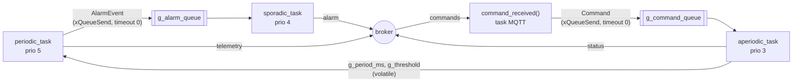

# Tema 02 – Rezolvare

Device-ul IoT din tema 01 rulează acum pe un **ESP32-C3 Super Mini**, cu trei taskuri FreeRTOS în locul celor trei thread-uri Java. Business-service-ul este rezolvarea din tema 01, adusă neschimbată.

## 1. Ce am modificat

| Fișier | Modificare |
|--------|------------|
| `start/esp32_device/esp32_device.ino` | TODO 0 … TODO 3: cele două cozi, cele trei taskuri, `command_received()`, pornirea în `setup()` |
| `start/esp32_device/config.h` | `STUDENT = "constantin-alexandru"` (Wi-Fi rămâne `iot-demo`) |
| `start/business-service/.../Config.java` | `STUDENT = "constantin-alexandru"` |
| `start/business-service/.../MessageProcessor.java` | TODO 4, copiat din tema 01 |
| `start/business-service/.../Dashboard.java` | TODO 5, copiat din tema 01 |
| `start/business-service/.../CommandConsole.java` | TODO 6, copiat din tema 01 |

`connection.h`, `connection.cpp` și restul claselor din business-service nu au fost atinse.

## 2. Cum am făcut

### Arhitectura



Corespondența cu tema 01:

| Tema 01 (Java) | Tema 02 (ESP32) |
|----------------|-----------------|
| `PeriodicTelemetryTask` | `periodic_task()` |
| `SporadicAlarmTask` | `sporadic_task()` |
| `AperiodicCommandTask` | `aperiodic_task()` + `execute_command()` |
| `BlockingQueue<Double> alarmEvents` | `g_alarm_queue`, elemente `AlarmEvent {temperature, threshold}` |
| `BlockingQueue<String> commands` | `g_command_queue`, elemente `Command {char text[64]}` |
| `volatile long periodMs`, `volatile double threshold` | `volatile uint32_t g_period_ms`, `volatile float g_threshold` |
| `DeviceSimulator` (pornirea thread-urilor) | `setup()` |

### TODO 0 – structura aplicației (`setup()`)

- Cozile se creează cu `xQueueCreate(8, sizeof(AlarmEvent))` și `xQueueCreate(8, sizeof(Command))` **înainte** de `mqtt_start()`, pentru că din acel moment pot sosi comenzi.
- Taskurile se pornesc cu `xTaskCreate(..., 4096, NULL, prioritate, NULL)` **după** `mqtt_start()`. Stiva de 4096 octeți ajunge pentru `snprintf` cu `%f`.
- Prioritățile:

| Task | Prioritate | De ce |
|------|-----------:|-------|
| periodic | 5 | are un termen la fiecare eliberare și cea mai scurtă perioadă (rate monotonic) |
| sporadic | 4 | cel mult un job la `MIN_INTERARRIVAL_MS` = 5 s |
| aperiodic | 3 | comenzile operatorului, fără constrângeri de timp; nu trebuie să întârzie telemetria |

Toate sunt între 2 și 19: peste `loopTask` (1), sub taskurile de evenimente și Wi-Fi (20, 23). Pe un singur nucleu, taskul periodic preemptează mereu celelalte două când este eliberat.

### TODO 1 – task periodic

```c
TickType_t last = xTaskGetTickCount();          // r_0
for (;;) {
    ...citire, publicare telemetry, eventual xQueueSend(alarmă, timeout 0)...
    xTaskDelayUntil(&last, pdMS_TO_TICKS(g_period_ms));   // r_{k+1} = r_k + T
}
```

- **Așteptare absolută:** `xTaskDelayUntil` așteaptă până la `last + T` și avansează `last` cu `T`, deci durata jobului (citire, `snprintf`, publicare) nu se adună la perioadă și nu apare derivă, spre deosebire de `vTaskDelay(T)`.
- Perioada și pragul se citesc la fiecare job, deci `SET_INTERVAL` / `SET_THRESHOLD` au efect de la următoarea eliberare.
- Dacă `xTaskDelayUntil` întoarce `pdFALSE`, jobul a depășit perioada. În acest caz grila se reia de la momentul curent (`last = xTaskGetTickCount()`), iar eliberările ratate se **sar**. Altfel, `xTaskDelayUntil` le-ar recupera pe toate în rafală, una după alta. Asta se întâmpla la pornire: primul `mqtt_publish` stă blocat câteva secunde cât timp clientul MQTT se conectează la broker, iar în prima variantă ieșeau apoi 6 mesaje de telemetrie la 1–2 ms unul de altul (vezi rezultatele).
- Când temperatura trece de prag, se pune în coadă un `AlarmEvent` cu temperatura și pragul **de la momentul măsurării**, cu timeout 0: taskul periodic nu se blochează niciodată pe coadă.

### TODO 2 – task sporadic

- Se blochează în `xQueueReceive(..., portMAX_DELAY)` până vine un eveniment.
- Măsoară intervalul de la ultima alarmă publicată cu `millis()` (timp monoton; `epoch_ms()` se poate modifica la resincronizarea SNTP). Scăderea pe `uint32_t` rămâne corectă și când `millis()` dă peste cap (după ~49 de zile).
- Evenimentele sosite la mai puțin de 5 s de ultima alarmă publicată sunt **respinse** (mesaj pe Serial). Prima alarmă este mereu acceptată (flag-ul `released`), nu depinde de cât timp a trecut de la pornire.
- Altfel publică `deviceId;timestamp;temperatura;prag` pe `alarm`.

### TODO 3 – task aperiodic și `command_received()`

- `command_received()` rulează pe taskul clientului MQTT; copiază textul într-un `struct Command` (pentru că `text` e valid doar în timpul apelului) și îl pune în coadă cu timeout 0. Nu execută nimic.
- `aperiodic_task()` preia comanda, elimină spațiile/`\r\n`, o împarte cu `strtok_r` și o execută în `execute_command()`:

| Comandă | Efect | Confirmare |
|---------|-------|------------|
| `SET_INTERVAL <ms>` | `g_period_ms = ms` (doar întreg > 0) | `OK SET_INTERVAL 1000` |
| `SET_THRESHOLD <v>` | `g_threshold = v` (doar număr finit) | `OK SET_THRESHOLD 35.00` |
| `RESET` | perioada și pragul revin la `PERIOD_MS_INITIAL`, `THRESHOLD_INITIAL` | `OK RESET period=2000 threshold=45.00` |
| `STATUS` | – | `OK STATUS period=2000 threshold=45.00` |
| altceva / parametru lipsă sau invalid | nimic | `ERROR ...` |

- Parametrii se validează cu `strtol` / `strtof` și verificarea `*end == '\0'`, deci `SET_INTERVAL abc` sau `SET_INTERVAL 10x` dau `ERROR`, iar taskul continuă.
- Numele comenzii este acceptat și cu litere mici (ca în tema 01, `toUpperCase`).
- Mesajele folosesc `%.2f` (mereu cu punct) și `%lld` pentru `epoch_ms()`, deci business-service le parsează cu `Double.parseDouble` / `Long.parseLong`, exact ca pe cele din simulator.

### Business-service (TODO 4 – 6)

Copiat din `tema-01-iot-mqtt/start/business-service` (aceeași rezolvare din tema 01): `MessageProcessor` preia mesajele, le salvează în CSV și actualizează `Dashboard` (un `LinkedHashMap` sincronizat cu ultima temperatură, ora ultimului mesaj și numărul de alarme); `CommandConsole` separă `deviceId` de comandă și o publică pe topic-ul `commands`. Placa apare în dashboard ca orice alt device (`esp32-xxxxxx`).

## 3. Cum am aplicat (compilare, încărcare, testare)

### Unelte

- Arduino IDE 2 (am folosit `arduino-cli` inclus în el), core **esp32 by Espressif Systems 3.3.x** (versiunea 2.x are alt API pentru clientul MQTT și nu compilează scheletul).
- Placa: **ESP32C3 Dev Module**, **USB CDC On Boot: Enabled**, portul USB al plăcii (la mine `COM7`).

```bash
arduino-cli core install esp32:esp32 --additional-urls https://espressif.github.io/arduino-esp32/package_esp32_index.json
arduino-cli compile --fqbn esp32:esp32:esp32c3:CDCOnBoot=cdc start/esp32_device
arduino-cli upload  --fqbn esp32:esp32:esp32c3:CDCOnBoot=cdc -p COM7 start/esp32_device
arduino-cli monitor -p COM7 -c baudrate=115200
```

Din Arduino IDE: deschideți `start/esp32_device/esp32_device.ino`, setați placa și portul ca mai sus, *Upload*, apoi *Serial Monitor* la 115200 baud.

### Business-service

```bash
cd start/business-service
mvn -q compile exec:java
```

### Scenariul de test

1. Pe Serial apare `=== tema 02: STUDENT constantin-alexandru, DEVICE_ID esp32-xxxxxx ===`, apoi conectarea la Wi-Fi, sincronizarea orei și `[mqtt] conectat ...`.
2. La fiecare 2 s: `[periodic] job la ... ms: esp32-xxxxxx;<timestamp>;<temp>`. În business-service, `show` afișează device-ul.
3. `esp32-xxxxxx SET_INTERVAL 1000` → telemetria vine la 1 s; confirmare `[STATUS] ... OK SET_INTERVAL 1000`.
4. `esp32-xxxxxx SET_THRESHOLD <temp - 1>` → fiecare job pune un eveniment; pe Serial apare o alarmă publicată, urmată de `alarmă RESPINSĂ` pentru cele din următoarele 5 s; în business-service apare `[ALARMA]` cel mult o dată la 5 s.
5. `esp32-xxxxxx STATUS` → `OK STATUS period=1000 threshold=...`.
6. `esp32-xxxxxx RESET` → perioada revine la 2000 ms, pragul la 45 °C, alarmele se opresc.
7. `esp32-xxxxxx SET_INTERVAL abc`, `esp32-xxxxxx FOO` → `ERROR ...`, placa continuă să publice.

### Rezultate

Testat pe 25.10.2026 cu placa `esp32-bdcb7c`, pe hotspot-ul telefonului (rețeaua `iot-demo` nu era disponibilă). Placa și business-service-ul au rulat în același timp; comenzile au fost trimise din consola business-service-ului.

Business-service (extras):

```
DEVICE           TEMP    ULTIMUL MESAJ   ALARME
esp32-bdcb7c    43.80         acum 0 s        0
Comandă trimisă către esp32-bdcb7c: SET_INTERVAL 1000
[STATUS] esp32-bdcb7c: OK SET_INTERVAL 1000
[STATUS] esp32-bdcb7c: OK STATUS period=1000 threshold=45.00
[STATUS] esp32-bdcb7c: OK SET_THRESHOLD 20.00
[ALARMA] esp32-bdcb7c: temperatura 44.80 > prag 20.00      (x4, la 5 s una de alta)
[STATUS] esp32-bdcb7c: ERROR SET_INTERVAL: invalid parameter
[STATUS] esp32-bdcb7c: ERROR unknown command: FOO
[STATUS] esp32-bdcb7c: ERROR SET_THRESHOLD: missing parameter
[STATUS] esp32-bdcb7c: OK RESET period=2000 threshold=45.00
[STATUS] esp32-bdcb7c: OK STATUS period=2000 threshold=45.00
DEVICE           TEMP    ULTIMUL MESAJ   ALARME
esp32-bdcb7c    44.80         acum 0 s        6
```

Mesajele au fost salvate în `data/telemetry.csv`, `data/alarm.csv` și `data/status.csv`.

Serial Monitor (extras), cu pragul la 20 °C și perioada de 1 s:

```
[sporadic] alarmă publicată: esp32-bdcb7c;1792929003929;44.80;20.00
[sporadic] alarmă RESPINSĂ: au trecut doar 1001 ms (minim 5000 ms)
[sporadic] alarmă RESPINSĂ: au trecut doar 2001 ms (minim 5000 ms)
[sporadic] alarmă RESPINSĂ: au trecut doar 3001 ms (minim 5000 ms)
[sporadic] alarmă RESPINSĂ: au trecut doar 4001 ms (minim 5000 ms)
[sporadic] alarmă publicată: esp32-bdcb7c;1792929008930;44.80;20.00
```

Intervalele dintre joburile taskului periodic, măsurate cu `millis()`:

| Faza | Intervale (ms) |
|------|----------------|
| `T = 2000` | 2000, 2001, 2000, 2000, … |
| după `SET_INTERVAL 1000` | 1000, 999, 1001, 1000, … |
| după `RESET` | 2000, 2000, 2000, … |

Grila nu derivă: abaterea e de cel mult ±1 ms (un tick FreeRTOS), iar în medie perioada rămâne exactă.

**Problema găsită la test și corectată:** în prima variantă, după primul job (blocat ~7 s în `mqtt_publish` cât timp clientul MQTT se conecta), `xTaskDelayUntil` a recuperat eliberările ratate în rafală: intervalele au fost `1 2 1 1 2 154` ms, apoi 2000. După corecția descrisă la TODO 1 urmează un singur job întârziat, apoi grila e la exact 2000 ms:

```
[periodic] eliberare ratată (jobul a depășit perioada), grila se reia de acum
[periodic] job la 8767 ms: ...
[periodic] job la 10768 ms: ...
[periodic] job la 12768 ms: ...
```

Observații:

- Imediat după pornire, temperatura cipului e ~44–46 °C, deci cu pragul inițial de 45 °C apar câteva alarme și după `RESET`, așa cum spune enunțul.
- Înainte de commit, `config.h` a fost readus la rețeaua `iot-demo`; parola hotspot-ului nu e în repository.
