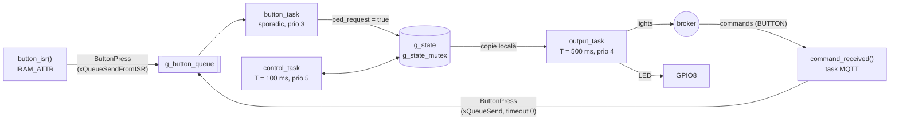

# Tema 03 – Rezolvare

Placa ESP32-C3 controlează trecerea de pietoni cu buton: un automat cu patru faze într-un task periodic de control, un al doilea task periodic care publică lămpile, iar butonul (BOOT sau **Buton pietoni** din dashboard) e tratat de un ISR și un task sporadic. Starea semaforului e partajată de trei taskuri și protejată de un mutex.

## 1. Ce am modificat

| Fișier | Modificare |
|--------|------------|
| `start/esp32_semafor/esp32_semafor.ino` | TODO 0 … TODO 3: starea și mutexul, coada butonului, cele trei taskuri, ISR-ul, `command_received()`, pornirea în `setup()` |
| `start/esp32_semafor/config.h` | `STUDENT = "constantin-alexandru"` (Wi-Fi rămâne `iot-demo`) |
| `start/dashboard/.../Config.java` | `STUDENT = "constantin-alexandru"` |
| `start/dashboard-web/.../Config.java` | `STUDENT = "constantin-alexandru"` |
| `test/test_semafor.py` | script de test (nou): citește Serial și MQTT, trimite `BUTTON`, verifică fazele și regulile de siguranță |

`connection.h`, `connection.cpp`, duratele din `config.h` și dashboard-urile (în afară de `STUDENT`) nu au fost atinse.

## 2. Cum am făcut

### Arhitectura



### TODO 0 – structura aplicației

Starea semaforului:

```c
struct LightState {
    Phase phase;              // faza curentă
    uint32_t phase_start_ms;  // momentul intrării în faza curentă (millis())
    bool ped_request;         // cererea pietonului (lampa AȘTEPTAȚI)
};
```

| Câmp | Scris de | Citit de |
|------|----------|----------|
| `phase`, `phase_start_ms` | control | control, ieșire, sporadic (doar pentru mesajul de pe Serial) |
| `ped_request` | sporadic (îl setează), control (îl șterge la intrarea în `PED_GREEN`) | control, ieșire |

- Elementul cozii butonului este `ButtonPress {time_ms, source}`: momentul apăsării (ms de la pornire, din tickuri) și sursa (`BOOT` sau `dashboard`), copiate în coadă, nu pointeri. Coada are 8 locuri.
- Mutexul (`xSemaphoreCreateMutex`) și coada se creează **înainte** de `mqtt_start()`; tot acolo se notează intrarea în faza inițială `CAR_GREEN`. Taskurile se pornesc după `mqtt_start()`, apoi se înregistrează întreruperea pe `FALLING`.
- Stiva fiecărui task: 4096 octeți.

Prioritățile, după Rate Monotonic (perioada mai mică, prioritatea mai mare):

| Task | Perioadă | Prioritate | De ce |
|------|----------|-----------:|-------|
| control | 100 ms | 5 | cea mai mică perioadă: el decide fazele, întârzierea lui lungește fazele |
| ieșire | 500 ms | 4 | perioada următoare |
| sporadic (buton) | min. 1000 ms între sosiri | 3 | tratat ca un task periodic cu perioada egală cu intervalul minim între sosiri |

Toate sunt între 2 și 19: peste `loopTask` (1), sub taskurile de sistem (Wi-Fi, evenimente). Joburile sunt foarte scurte (sub o milisecundă, în afară de `mqtt_publish`, care doar pune mesajul în clientul MQTT), deci utilizarea procesorului e mică și toate termenele sunt respectate.

### Regulile pentru mutex

- Se ține doar cât se citesc sau se scriu câmpurile. Taskul de ieșire copiază toată starea într-o variabilă locală (`LightState s = g_state;`) și eliberează mutexul înainte de `snprintf`, `mqtt_publish` și `digitalWrite`.
- Cu mutexul luat: fără `Serial`, fără `mqtt_publish`, fără așteptări. Taskul de control și cel sporadic rețin ce vor să afișeze în variabile locale și scriu pe Serial după `xSemaphoreGive`.
- ISR-ul nu atinge mutexul: doar pune apăsarea în coadă.
- `millis()` se citește tot sub mutex, ca timpul să corespundă stării citite. Altfel, taskul de ieșire putea fi preemptat de control între copiere și `millis()` și calcula o numărătoare dintr-o fază cu momentul de acum.

### TODO 1 – taskul periodic de control

```c
TickType_t last = xTaskGetTickCount();          // r_0
for (;;) {
    take(mutex);
    lasted = millis() - phase_start_ms;
    if (lasted >= durata(phase)) { ...faza următoare..., phase_start_ms = now; }
    give(mutex);
    if (changed) Serial.printf(...);
    if (xTaskDelayUntil(&last, T) == pdFALSE) last = xTaskGetTickCount();
}
```

- Automatul e un `switch` pe fază. `CAR_GREEN` are doar durată minimă: trece în `CAR_YELLOW` după `CAR_GREEN_MIN_MS` **și** doar dacă `ped_request` e setat; fără cerere, verdele continuă oricât. Celelalte faze se termină doar prin trecerea timpului.
- La intrarea în `PED_GREEN` se șterge `ped_request`. O apăsare venită în timpul `PED_GREEN` setează din nou cererea, deci după următorul verde minim pornește un ciclu nou.
- Duratele se măsoară cu `millis()` (monoton), nu cu `epoch_ms()`, care poate sări la resincronizarea SNTP. Scăderea pe `uint32_t` rămâne corectă și după ce `millis()` dă peste cap.
- **Așteptare absolută** cu `xTaskDelayUntil`: eliberările sunt pe grila r_k = r_0 + kT, fără derivă. Dacă un job depășește perioada (`pdFALSE`), grila se reia de acum, fără rafală de joburi întârziate (aceeași problemă ca în tema 02).
- Faza nouă se notează cu momentul jobului care a observat expirarea, deci o fază poate dura cu până la 100 ms peste valoarea din `config.h` (la test: 0–13 ms în plus, vezi mai jos).

### TODO 2 – taskul periodic de ieșire

- Lămpile din faza copiată: `CAR_GREEN` → `GREEN/RED`, `CAR_YELLOW` → `YELLOW/RED`, `ALL_RED` → `RED/RED`, `PED_GREEN` → `RED/GREEN`. Pietonii au verde doar în `PED_GREEN`, unde mașinile au roșu, iar din `CAR_GREEN` se iese doar prin `CAR_YELLOW`, deci cele două reguli de siguranță sunt respectate prin construcție.
- Numărătoarea: în `PED_GREEN`, `(rămas + 999) / 1000` (rotunjire în sus: 7,2 s → 8, 0,3 s → 1); în celelalte faze 0. Pentru că `PED_GREEN` poate dura până la 100 ms peste 8 s, cât timp faza e încă `PED_GREEN` numărătoarea nu coboară sub 1 (0 ar însemna „nu se afișează” cu pietonii pe verde).
- Mesajul `deviceId;epoch_ms;faza;masini;pietoni;asteptati;secunde` se publică la fiecare job, cu `%lld` pentru `epoch_ms()`.
- LED-ul plăcii (`GPIO8`, aprins pe `LOW`) urmează lampa AȘTEPTAȚI.
- Tot cu `xTaskDelayUntil` și aceeași tratare a eliberărilor ratate. La pornire, primul `mqtt_publish` poate aștepta până se conectează clientul MQTT.

### TODO 3 – butonul: ISR, `command_received()`, taskul sporadic

- `button_isr()` (`IRAM_ATTR`) construiește un `ButtonPress` cu `xTaskGetTickCountFromISR()` și îl pune în coadă cu `xQueueSendFromISR`, apoi `portYIELD_FROM_ISR(woken)`. Nimic altceva: fără Serial, fără mutex, fără filtrare de bounce.
- `command_received()` rulează pe taskul clientului MQTT. Taie spațiile și `\r\n` de la capete și, dacă textul este `BUTTON` (acceptat și cu litere mici), pune în coadă un `ButtonPress` cu momentul de acum, cu **timeout 0**. Dacă coada e plină, afișează pe Serial și apăsarea se pierde. Orice altă comandă se ignoră.
- `button_task()` stă blocat în `xQueueReceive(..., portMAX_DELAY)`. Pentru fiecare apăsare compară `press.time_ms`, adică momentul sosirii pus de ISR sau de `command_received()`, nu momentul preluării, cu ultima apăsare **acceptată**:
  - sub `MIN_INTERARRIVAL_MS` (1000 ms): **respinsă**, cu mesaj pe Serial. Așa se filtrează și bounce-ul butonului BOOT;
  - altfel: acceptată, setează `ped_request` sub mutex și afișează dacă cererea e nouă sau exista deja.
- Prima apăsare se acceptă mereu (flag-ul `accepted_once`), oricât de devreme după pornire ar veni.

## 3. Cum am aplicat (compilare, încărcare, testare)

### Unelte

- `arduino-cli` din Arduino IDE 2, core **esp32 3.3.2**, placa **ESP32C3 Dev Module** cu **USB CDC On Boot: Enabled**, portul plăcii `COM8`.

```bash
arduino-cli compile --fqbn esp32:esp32:esp32c3:CDCOnBoot=cdc start/esp32_semafor
arduino-cli upload  --fqbn esp32:esp32:esp32c3:CDCOnBoot=cdc -p COM8 start/esp32_semafor
```

Rezultat compilare: 1 089 166 octeți (83 % din flash), 36 944 octeți RAM global.

- Dashboard-urile: `cd start/dashboard && mvn -q compile exec:java` (sau `dashboard-web`, ori pagina [control.aut.utcluj.ro/semafor/?student=constantin-alexandru](https://control.aut.utcluj.ro/semafor/?student=constantin-alexandru)).

### Scriptul de test (`test/test_semafor.py`)

Dashboard-ul se folosește cu mâna. Ca să am rezultate măsurate și reproductibile, am scris un script Python care face același lucru ca dashboard-ul, plus măsurători:

- citește Serial-ul plăcii (`pyserial`) și se abonează la `ssatr/constantin-alexandru/#` (`paho-mqtt`);
- verifică la fiecare mesaj `lights` formatul (7 câmpuri) și **regulile de siguranță** din dashboard: pietoni `GREEN` doar cu mașini `RED`, mașini `GREEN → RED` doar prin `YELLOW`;
- trimite `BUTTON` pe `commands`, ca butonul **Buton pietoni**, și rulează scenariile de mai jos;
- la final, calculează durata fiecărei faze, numărătorile și intervalele dintre mesajele `lights`.

```bash
pip install paho-mqtt pyserial
python test/test_semafor.py COM8 run.log
```

| # | Scenariu | Ce se așteaptă |
|---|----------|----------------|
| 1 | 15 s fără apăsări | doar `CAR_GREEN` |
| 2 | `BUTTON` cu mașinile pe verde de peste 10 s | AȘTEPTAȚI imediat, galben imediat, apoi ciclul complet 3 s + 2 s + 8 s cu numărătoarea 8 … 1 |
| 2b | `BUTTON` în timpul `PED_GREEN` | cererea rămâne; după 10 s de verde pentru mașini, un nou ciclu |
| 3 | `BUTTON` la 3 s după intrarea în `CAR_GREEN` | AȘTEPTAȚI imediat, galbenul abia la 10 s |
| 4 | 4 × `BUTTON` la 200 ms | prima acceptată, celelalte respinse (mesaj pe Serial) |

### Rezultate

Testat pe 21.11.2026 cu placa `esp32-c88c30`, pe hotspot-ul telefonului (rețeaua `iot-demo` nu era disponibilă).

**Toate scenariile au trecut, iar verificările de siguranță și de format nu au găsit nicio eroare** (214 mesaje `lights`).

Serial Monitor (extras), cu tranzițiile taskului de control și deciziile taskului sporadic:

```
[mqtt] comandă primită: BUTTON
[buton] apăsare dashboard acceptată la 120455 ms, în faza CAR_GREEN: cerere înregistrată
[control] 120468 ms: faza CAR_YELLOW (precedenta a durat 16500 ms)
[control] 123468 ms: faza ALL_RED (precedenta a durat 3000 ms)
[control] 125468 ms: faza PED_GREEN (precedenta a durat 2000 ms)
[buton] apăsare dashboard acceptată la 127954 ms, în faza PED_GREEN: cerere înregistrată
[control] 133468 ms: faza CAR_GREEN (precedenta a durat 8000 ms)
[control] 143468 ms: faza CAR_YELLOW (precedenta a durat 10000 ms)     <- ciclul cerut în PED_GREEN
...
[buton] apăsare dashboard acceptată la 159941 ms, în faza CAR_GREEN: cerere înregistrată   <- la 3 s de verde
[control] 166468 ms: faza CAR_YELLOW (precedenta a durat 10000 ms)     <- galben abia la 10 s
...
[buton] apăsare dashboard acceptată la 180942 ms, în faza CAR_GREEN: cerere înregistrată
[buton] apăsare dashboard RESPINSĂ: au trecut doar 49 ms (minim 1000 ms)
[buton] apăsare dashboard RESPINSĂ: au trecut doar 252 ms (minim 1000 ms)
[buton] apăsare dashboard RESPINSĂ: au trecut doar 510 ms (minim 1000 ms)
```

Mesajele `lights` pentru un ciclu (scenariul 2):

```
esp32-c88c30;1795259358861;CAR_YELLOW;YELLOW;RED;1;0
...
esp32-c88c30;1795259361861;ALL_RED;RED;RED;1;0
...
esp32-c88c30;1795259363861;PED_GREEN;RED;GREEN;0;8
esp32-c88c30;1795259364361;PED_GREEN;RED;GREEN;0;8
esp32-c88c30;1795259364861;PED_GREEN;RED;GREEN;0;7
...
```

Duratele fazelor:

| Faza | `config.h` | Pe Serial (taskul de control) | Din mesajele `lights` (rezoluție 0,5 s) |
|------|-----------:|------------------------------:|----------------------------------------:|
| `CAR_GREEN` (cu cerere) | ≥ 10 000 ms | 10 000 ms | 9,99 – 10,00 s |
| `CAR_YELLOW` | 3 000 ms | 3 000 ms | 2,98 – 3,02 s |
| `ALL_RED` | 2 000 ms | 2 000 ms | 1,97 – 2,00 s |
| `PED_GREEN` | 8 000 ms | 8 000 ms | 7,99 – 8,04 s |

- Tranzițiile se fac exact pe grila de 100 ms a taskului de control (toate la `...468 ms`), deci fără derivă. Duratele ies exact cele din `config.h`, pentru că sunt multipli de perioada de control.
- Numărătoarea pe fiecare ciclu: `8, 8, 7, 7, 6, 6, 5, 5, 4, 4, 3, 3, 2, 2, 1, 1`, adică două mesaje pe secundă, rotunjite în sus, fără 0 în `PED_GREEN`.
- Intervalul dintre mesajele `lights`, măsurat la PC: medie 500 ms, min 430 ms / max 570 ms. Variația vine din rețea (hotspot + broker); pe placă eliberările sunt la exact 500 ms.
- AȘTEPTAȚI vizibilă în `lights` la **478 ms** după trimiterea `BUTTON` de pe PC. Asta include drumul prin broker (~275 ms până la placă) și așteptarea jobului următor al taskului de ieșire (până la 500 ms).
- Apăsarea a sosit în `CAR_GREEN` după 16,5 s de verde, așa că taskul de control a trecut în `CAR_YELLOW` la 13 ms după ea. De aceea primul mesaj cu `asteptati = 1` are deja faza `CAR_YELLOW`, ca în rândul „≈ 0 s” din tabelul din enunț.
- Respingerea de 49 ms din scenariul 4: două comenzi `BUTTON` trimise la 200 ms au ajuns la placă aproape împreună (jitter de rețea). Intervalul e măsurat la sosirea pe placă, deci a doua apăsare a fost respinsă corect.

Observații:

- Testele automate au folosit butonul din dashboard (comanda `BUTTON`). Butonul fizic BOOT trece prin ISR în aceeași coadă și prin același task sporadic, dar nu a fost apăsat în timpul testului înregistrat.
- Înainte de commit, `config.h` a fost readus la rețeaua `iot-demo`; parola hotspot-ului nu e în repository.
